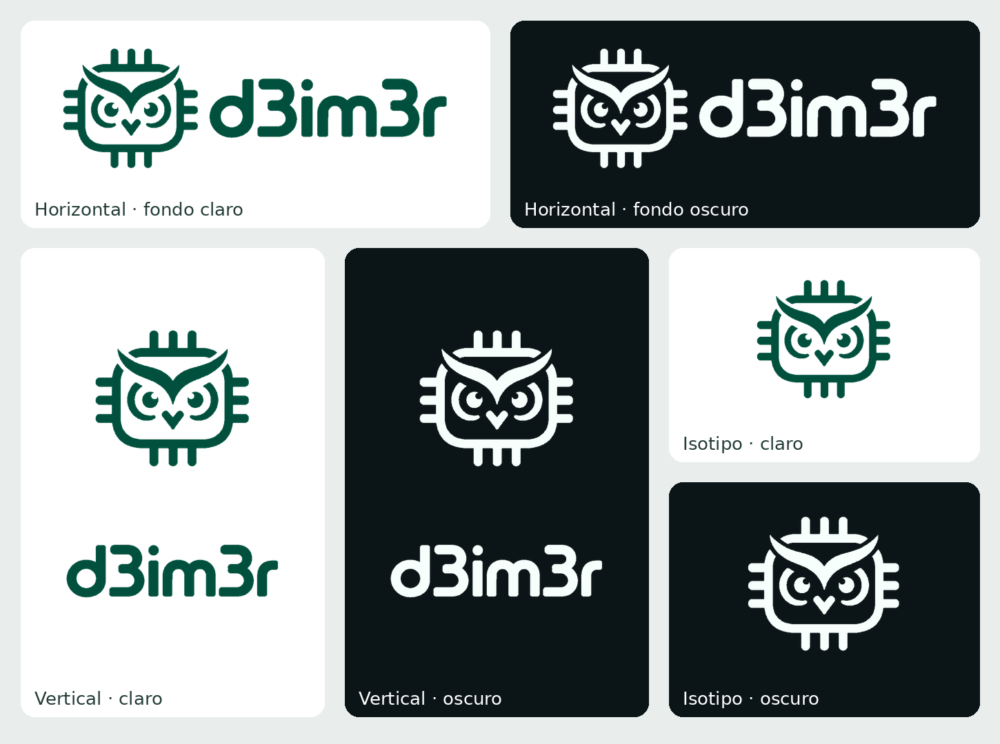

<div align="center">
  <picture>
    <source media="(prefers-color-scheme: dark)" srcset="assets/svg/horizontal-dark.svg" />
    
  </picture>
  <p>Official visual identity, design system reference, and starter foundation for d3im3r projects.</p>
</div>



Este repositorio contiene la identidad visual oficial, los recursos vectoriales y las bases de diseño de [@d3im3r](https://github.com/d3im3r).

> **💡 Principio de uso (Autonomía por proyecto):**  
> Este repositorio funciona como **guía de referencia y plantilla de inicio (starter kit)**, **no como una dependencia externa de tiempo de ejecución**. Cada nuevo proyecto toma estos activos, tokens y componentes como cimientos en su propio repositorio, permitiéndole forjar su propia identidad de forma completamente autónoma sin depender de imports externos.

---

## Recursos disponibles

| Recurso | Descripción |
| --- | --- |
| [`styles/theme.css`](styles/theme.css) | Hoja de estilos base con tokens semánticos duales (Dark/Light) y compatibilidad nativa con Tailwind CSS v4 `@theme` |
| [`tokens/`](tokens/) | Especificación de diseño en [`colors.json`](tokens/colors.json), variables CSS y preset para Tailwind v3 ([`tailwind.preset.js`](tokens/tailwind.preset.js)) |
| [`snippets/`](snippets/) | Plantillas React listas para copiar: [`use-theme.ts`](snippets/use-theme.ts) (hook de tema), [`theme-toggle.tsx`](snippets/theme-toggle.tsx) (botón Luna/Sol), [`brand-signature.tsx`](snippets/brand-signature.tsx) (firma d3im3r) y [`app-header.tsx`](snippets/app-header.tsx) (encabezado unificado de microROS Studio / FlasherLab / d3im3r-class) |
| [`assets/favicon/`](assets/favicon/) | Favicons listos para `public/`: SVG con modo oscuro adaptativo, ICO multi-resolución, PNGs y `site.webmanifest` |
| [`assets/svg/`](assets/svg/) | Logotipos vectoriales en orientaciones horizontal y vertical, versiones con y sin fondo |
| [`assets/png/`](assets/png/) | Exportaciones raster en resoluciones estandarizadas (128px a 2048px) |
| [`sources/`](sources/) | Ilustraciones fuente originales en alta resolución |

---

## 🎨 Paleta de Referencia y Tokens Semánticos

La base de diseño d3im3r proporciona una estructura de alto contraste pensada para dashboards técnicos, herramientas de desarrollo y sistemas embebidos. Inicia en **Modo Oscuro por defecto** y cuenta con soporte completo para **Modo Claro**:

| Rol Semántico | 🌙 Modo Oscuro (Default) | ☀️ Modo Claro | Variable CSS | Utilidad Tailwind |
| :--- | :--- | :--- | :--- | :--- |
| **Fondo Principal (Background)** | `#0B1727` | `#F4F7FB` | `--app-bg` / `--background` | `bg-app-bg` |
| **Paneles y Tarjetas (Panel)** | `#101E30` | `#FFFFFF` | `--app-panel` / `--card` | `bg-app-panel` |
| **Bordes y Rejilla (Grid)** | `#35516B` | `#CBD5E1` | `--app-grid` / `--border` | `border-app-grid` |
| **Texto Principal (Text)** | `#FFFFFF` | `#172B45` | `--app-text` / `--foreground` | `text-app-text` |
| **Texto Secundario (Muted)** | `#A5B4C7` | `#64748B` | `--app-muted` / `--muted-foreground` | `text-app-muted` |
| **Estado Activo (Green)** | `#4ADE80` | `#16A34A` | `--app-green` / `--secondary` | `text-app-green` |
| **Acento Principal (Cyan)** | `#22D3EE` | `#0891B2` | `--app-cyan` / `--primary` | `text-app-cyan` |
| **Advertencias (Orange)** | `#FFAD35` | `#D97706` | `--app-orange` / `--chart-3` | `text-app-orange` |
| **Alarmas y Errores (Red)** | `#FB7185` | `#DC4660` | `--app-red` / `--destructive` | `text-app-red` |

---

## 🚀 Cómo iniciar un nuevo proyecto con estas bases

Al comenzar una nueva aplicación o sitio web, sigue estos pasos para adoptar los cimientos y personalizar su identidad:

### 1. Copiar los estilos a tu proyecto
Copia el contenido de [`styles/theme.css`](styles/theme.css) directamente al archivo de estilos globales de tu proyecto (por ejemplo `src/app/globals.css` o `src/index.css`).

Esto le da a tu proyecto:
* Tokens CSS semánticos (`--app-bg`, `--app-cyan`, etc.) y compatibles con librerías como Shadcn UI.
* Modo oscuro automático con soporte de cambio mediante `data-theme="light"` o la clase `.light`.
* Compatibilidad instantánea con Tailwind CSS v4 para aplicar opacidades con `color-mix` (ej: `bg-app-cyan/15`, `border-app-grid/50`).

### 2. Copiar los componentes reactivos de tema y header
Copia los archivos de la carpeta [`snippets/`](snippets/) en tu estructura de componentes:
* `snippets/use-theme.ts` ➡️ `src/hooks/use-theme.ts` (maneja la persistencia en `localStorage` y las clases en `<html>`).
* `snippets/theme-toggle.tsx` ➡️ `src/components/theme-toggle.tsx` (botón con iconos interactivos de Luna y Sol).
* `snippets/brand-signature.tsx` ➡️ `src/components/brand-signature.tsx` (renderizado automático del logo d3im3r según el tema activo).
* `snippets/app-header.tsx` ➡️ `src/components/app-header.tsx` (estructura completa de encabezado del ecosistema con logo propio + firma d3im3r, selector de idioma, perfil, ayuda y atajo a GitHub).

### 3. Copiar los favicons a tu carpeta `public/`
Copia los contenidos de [`assets/favicon/`](assets/favicon/) directamente a la carpeta `public/` de tu aplicación y referéncialos localmente en tu HTML:

```html
<!-- Favicon SVG adaptativo al tema del navegador -->
<link rel="icon" type="image/svg+xml" href="/favicon.svg" />

<!-- Fallback PNG estándar -->
<link rel="icon" type="image/png" sizes="32x32" href="/favicon-32x32.png" />

<!-- Icono para dispositivos Apple -->
<link rel="apple-touch-icon" sizes="180x180" href="/apple-touch-icon.png" />

<!-- Manifiesto de aplicación web -->
<link rel="manifest" href="/site.webmanifest" />
```

### 4. Forjar la identidad propia de la aplicación
Una vez copiados los archivos base, cada proyecto es libre de:
* Cambiar o agregar acentos propios de la aplicación (por ejemplo, definir colores especializados para tipos de nodos, flujos de datos o estados de hardware).
* Diseñar iconos o símbolos específicos adaptados a la funcionalidad del proyecto.
* Ajustar tipografías o radios de borde sin temor a romper otras aplicaciones.

---

## Licencia y uso

El repositorio y todo su contenido (arte, logotipos, símbolos, iconos, favicons, especificaciones de tokens y plantillas) están disponibles para uso libre, comercial y personal, sin necesidad de autorización previa, atribución obligatoria ni pagos. Consulta [`LICENSE`](LICENSE) para más detalles.

Consulta [`BRAND.md`](BRAND.md) para más pautas conceptuales y de arquitectura de diseño.
