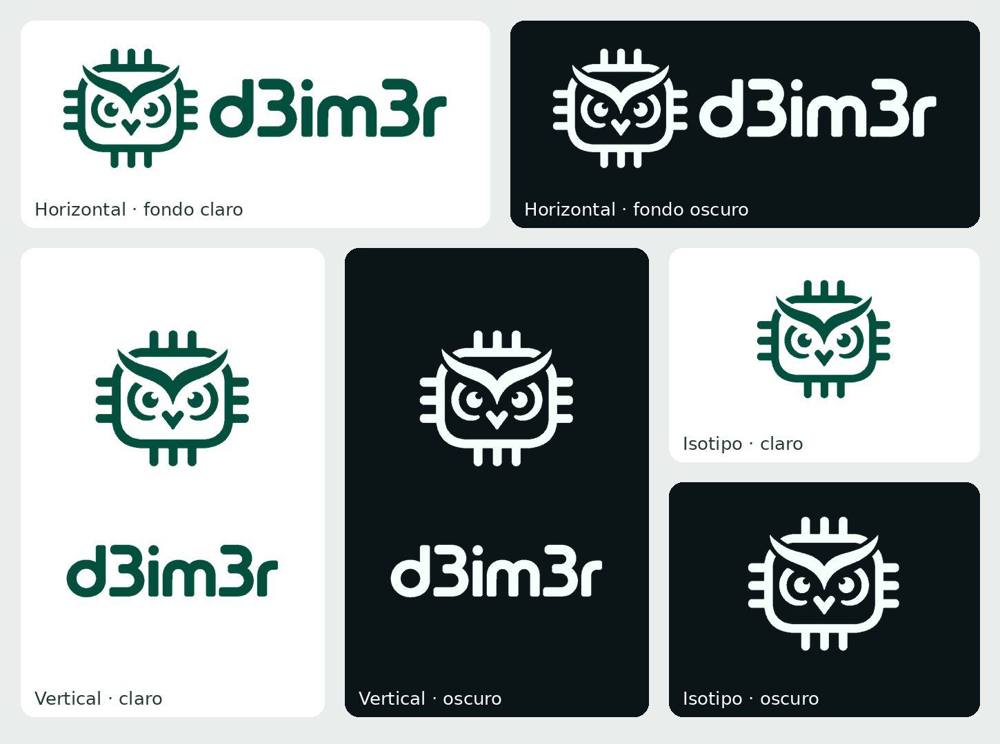

<div align="center">
  <picture>
    <source media="(prefers-color-scheme: dark)" srcset="assets/svg/horizontal-dark.svg" />
    
  </picture>
  <p>Official visual identity for d3im3r websites, software, and embedded-systems projects.</p>
</div>



The official visual identity for projects created by [@d3im3r](https://github.com/d3im3r). The owl-chip combines an owl with microcontroller-inspired geometry and the `{o⌄o}` signature.

## Assets

| Resource | Contents |
| --- | --- |
| [`assets/svg/`](assets/svg/) | Scalable horizontal and vertical logos, plus standalone symbols |
| [`assets/png/`](assets/png/) | Raster exports in multiple sizes, with transparent and opaque-background variants |
| [`assets/favicon/`](assets/favicon/) | Browser and app icons in SVG, PNG, and ICO formats |

Choose `*-light` assets for light surfaces and `*-dark` for dark surfaces. Files with `-background` have an opaque background; the others are transparent. SVG is recommended where supported.

## Web usage

The examples below use the `main` branch. For production deployments, replace `@main` with a published release tag to pin the asset version.

### Responsive light/dark logo

```html
<picture>
  <source
    media="(prefers-color-scheme: dark)"
    srcset="https://cdn.jsdelivr.net/gh/d3im3r/d3im3r-brand-assets@main/assets/svg/horizontal-dark.svg"
  />
  
</picture>
```

### Favicon

```html
<link
  rel="icon"
  type="image/svg+xml"
  href="https://cdn.jsdelivr.net/gh/d3im3r/d3im3r-brand-assets@main/assets/favicon/favicon.svg"
/>
<link
  rel="icon"
  type="image/png"
  sizes="32x32"
  href="https://cdn.jsdelivr.net/gh/d3im3r/d3im3r-brand-assets@main/assets/favicon/favicon-32x32.png"
/>
```

## License and usage

The repository and all its contents, including artwork, logos, symbols, icons, favicons, and the `d3im3r` brand elements, are freely available for personal and commercial use, modification, redistribution, sublicensing, resale, and publication. No authorization issue, prior approval, attribution, or payment is required. See [`LICENSE`](LICENSE) for the full permission grant.

See [`BRAND.md`](BRAND.md) for optional brand usage recommendations.
