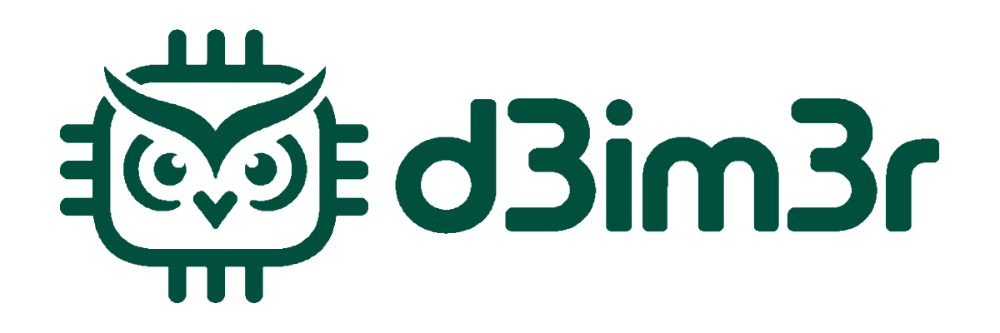

<div align="center">
  <picture>
    <source media="(prefers-color-scheme: dark)" srcset="assets/svg/horizontal-dark.svg" />
    
  </picture>
  <p>Official visual identity & design system for d3im3r websites, software, and embedded-systems projects.</p>
</div>


The official visual identity for projects created by [@d3im3r](https://github.com/d3im3r). The owl-chip combines an owl with microcontroller-inspired geometry and the `{o⌄o}` signature.

## Resources

| Resource | Contents |
| --- | --- |
| [`assets/svg/`](assets/svg/) | Scalable horizontal and vertical logos, plus standalone symbols |
| [`assets/png/`](assets/png/) | Raster exports in multiple sizes (128px–2048px), transparent and opaque variants |
| [`assets/favicon/`](assets/favicon/) | Browser and app icons in adaptive SVG, multi-size ICO, PNGs, and web manifest |
| [`styles/theme.css`](styles/theme.css) | Single-import CSS theme with dark/light mode tokens and Tailwind CSS v4 `@theme` |
| [`tokens/`](tokens/) | Design tokens in JSON ([`colors.json`](tokens/colors.json)), CSS, and Tailwind v3 preset |
| [`snippets/`](snippets/) | Ready-to-use React templates: [`use-theme.ts`](snippets/use-theme.ts) & [`theme-toggle.tsx`](snippets/theme-toggle.tsx) |
| [`sources/`](sources/) | Raw, high-resolution source graphics |

Choose `*-light` assets for light surfaces and `*-dark` for dark surfaces. Files with `-background` have an opaque background; the others are transparent. SVG is recommended where supported.

---

## 🎨 Dual Color Palette & Design Tokens

d3im3r uses a high-contrast dual theme (Dark by default, Light mode supported):

| Semantic Role | 🌙 Dark Mode (Default) | ☀️ Light Mode | CSS Variable | Tailwind Utility |
| :--- | :--- | :--- | :--- | :--- |
| **Background** | `#0B1727` | `#F4F7FB` | `--app-bg` / `--background` | `bg-app-bg` |
| **Panel / Card** | `#101E30` | `#FFFFFF` | `--app-panel` / `--card` | `bg-app-panel` |
| **Grid / Border** | `#35516B` | `#CBD5E1` | `--app-grid` / `--border` | `border-app-grid` |
| **Text** | `#FFFFFF` | `#172B45` | `--app-text` / `--foreground` | `text-app-text` |
| **Muted** | `#A5B4C7` | `#64748B` | `--app-muted` / `--muted-foreground` | `text-app-muted` |
| **Active / Green** | `#4ADE80` | `#16A34A` | `--app-green` / `--secondary` | `text-app-green` |
| **Accent / Cyan** | `#22D3EE` | `#0891B2` | `--app-cyan` / `--primary` | `text-app-cyan` |
| **Warning / Orange** | `#FFAD35` | `#D97706` | `--app-orange` / `--chart-3` | `text-app-orange` |
| **Error / Red** | `#FB7185` | `#DC4660` | `--app-red` / `--destructive` | `text-app-red` |

See [`BRAND.md`](BRAND.md) for full design guidelines and architectural token mappings.

---

## Web usage

The examples below use the published tag `@v1.0.0` for production pinning (or replace with `@main` for bleeding-edge).

### 1. Import Theme & Styles (Tailwind / CSS)

Import the official stylesheet into your project (`globals.css` or HTML):

```css
@import "https://cdn.jsdelivr.net/gh/d3im3r/d3im3r-brand-assets@v1.0.0/styles/theme.css";
```

This immediately enables:
* Native CSS variables (`--app-bg`, `--app-panel`, etc.) and Shadcn-compatible tokens.
* Dark mode as the default, switching to light mode with `data-theme="light"` or `.light`.
* Automatic Tailwind CSS v4 `@theme inline` support with opacity modifiers (e.g., `bg-app-cyan/15`, `border-app-grid/60`).

### 2. Responsive Light/Dark Logo

```html
<picture>
  <source
    media="(prefers-color-scheme: dark)"
    srcset="https://cdn.jsdelivr.net/gh/d3im3r/d3im3r-brand-assets@v1.0.0/assets/svg/horizontal-dark.svg"
  />
  
</picture>
```

### 3. Favicon & Web Manifest

```html
<!-- Adaptive SVG Favicon (automatic dark/light contrast) -->
<link
  rel="icon"
  type="image/svg+xml"
  href="https://cdn.jsdelivr.net/gh/d3im3r/d3im3r-brand-assets@v1.0.0/assets/favicon/favicon.svg"
/>

<!-- Standard 32x32 PNG fallback -->
<link
  rel="icon"
  type="image/png"
  sizes="32x32"
  href="https://cdn.jsdelivr.net/gh/d3im3r/d3im3r-brand-assets@v1.0.0/assets/favicon/favicon-32x32.png"
/>

<!-- Apple Touch Icon -->
<link
  rel="apple-touch-icon"
  sizes="180x180"
  href="https://cdn.jsdelivr.net/gh/d3im3r/d3im3r-brand-assets@v1.0.0/assets/favicon/apple-touch-icon.png"
/>

<!-- Web App Manifest (PWA / Mobile) -->
<link
  rel="manifest"
  href="https://cdn.jsdelivr.net/gh/d3im3r/d3im3r-brand-assets@v1.0.0/assets/favicon/site.webmanifest"
/>
```

---

## License and usage

The repository and all its contents, including artwork, logos, symbols, icons, favicons, design tokens, and the `d3im3r` brand elements, are freely available for personal and commercial use, modification, redistribution, sublicensing, resale, and publication. No authorization issue, prior approval, attribution, or payment is required. See [`LICENSE`](LICENSE) for the full permission grant.

See [`BRAND.md`](BRAND.md) for optional brand usage recommendations.
